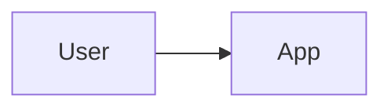

# foundry-sandbox: Architecture

| Field | Value |
| --- | --- |
| Status | draft |
| Version | 0.1 |
| Owner | Bassem-Zohdy |
| Approver | Bassem-Zohdy |
| Date approved | not yet approved |

How the system is put together. Draw diagrams in Mermaid so they are versioned and reviewable.

## Context

## Components

## Data and tenancy

## Decisions

Record each significant decision as an ADR in `docs/adr/`.

## Bounded contexts

## Context map

## Layers

## Identity model

## Trust boundaries

## CORS

## Rate limiting

## Security headers

## Threat model

## Delivery and edge

## Runtime contract
